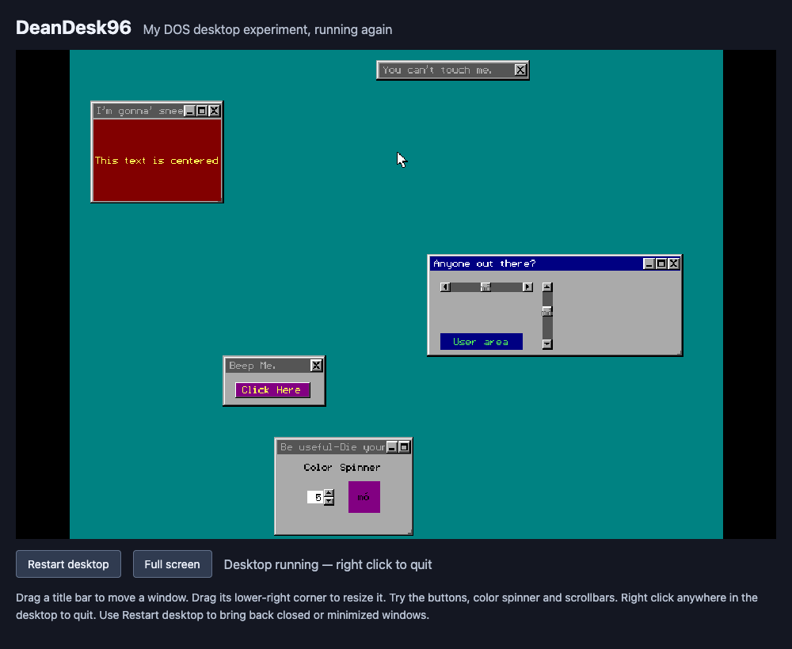

[](https://x.com/deanthecoder) [](https://github.com/deanthecoder/DeanDesk96/stargazers)

# DeanDesk96

**[Run DeanDesk96](https://deanthecoder.github.io/DeanDesk96/)**

A restoration of my DOS desktop experiment: movable windows, a color spinner, scrollbars and a very short PC-speaker beep, now running in a browser.



## Why I wrote it

I was only a teenager when Windows 95 came out, and I was amazed at how cool it looked. After spending much of my childhood using DOS, and then some time using Windows 3.11, the graphics in '95 were on a whole new level.

Not having much money, I thought I'd try writing my own version of the UI using C...

## Run locally

On macOS, double-click **Launch.command**, or run:

```sh
./run.sh
```

The launcher starts a web server on an available local port and opens your browser. Click **Start desktop**. Keep the terminal open while using it; press Control+C there to stop the server.

Python 3 is required for the launcher. The browser loads the emulator and original program from this folder, so no online service, account or build step is needed.

## Try the desktop

- Drag a window's title bar to move it. The original red XOR outline follows the mouse; the window moves when you release it.
- Drag the small lower-right resize indicator to change a window's size.
- Use the original close, maximize, restore and minimize buttons. Individual windows have different combinations of these controls.
- **Click Here** beeps and cycles the button's background color.
- The **Color Spinner** changes the adjacent swatch through the 16 VGA colors.
- The scrollbars in **Anyone out there?** respond to their arrows and track.
- Clicking **User area** beeps.
- Right click to quit to DOS. **Restart desktop** reloads the app so closed and minimized windows return. The original program has no taskbar or way to reopen a minimized window.

Full screen is available below the display. The 640 × 480 screen scales to fit the browser; mouse positions are mapped back to the original resolution.

## Preserving the implementation

This version executes the **unmodified `DESK.EXE` in browser DOSBox**, using a locally bundled js-dos runtime. The desktop is the original program, including its Borland BGI drawing routines, small vector font, control icons, window ordering, callbacks, mouse polling and PC-speaker sound. The JavaScript page starts the program, sizes the display and adds restart/full-screen controls.

The archive's C source files are dated **June 2, 1995**, its icon definitions **May 31, 1995**, and the surviving executable **December 11, 1996**. These are preserved file dates, not independently verified release dates. **DeanDesk96** refers to the surviving executable.

[`original/`](original/) preserves `DESK.C`, `DESK.H`, `ICONS` and `DESK.EXE` byte for byte. [`original/shared/MOUSE.C`](original/shared/MOUSE.C) is the shared mouse module found in the adjacent development library. The original archive has not been modified. [`original/SHA256SUMS`](original/SHA256SUMS) records the preserved files' checksums.

The source uses Borland `graphics.h`, a linked `EGAVGA_driver` and `small_font`; those toolchain libraries are not part of the surviving project folder. Rebuilding the executable from source has not been verified, and the newer executable may differ from the source snapshot.

Original quirks are visible. For example, the color swatch has an empty caption in `DESK.C`, but `label()` only allocates caption memory for nonempty strings. The executable consequently draws stray characters in that swatch. This restoration preserves that behavior.

Cool to see some of the actual bugs in the code too!

## Licenses

The new host page and Dean's original source are MIT licensed; see [LICENSE](LICENSE). The bundled js-dos/DOSBox runtime has its own GPLv2 license. See [THIRD_PARTY.md](THIRD_PARTY.md) for runtime provenance and the original Borland toolchain components.
